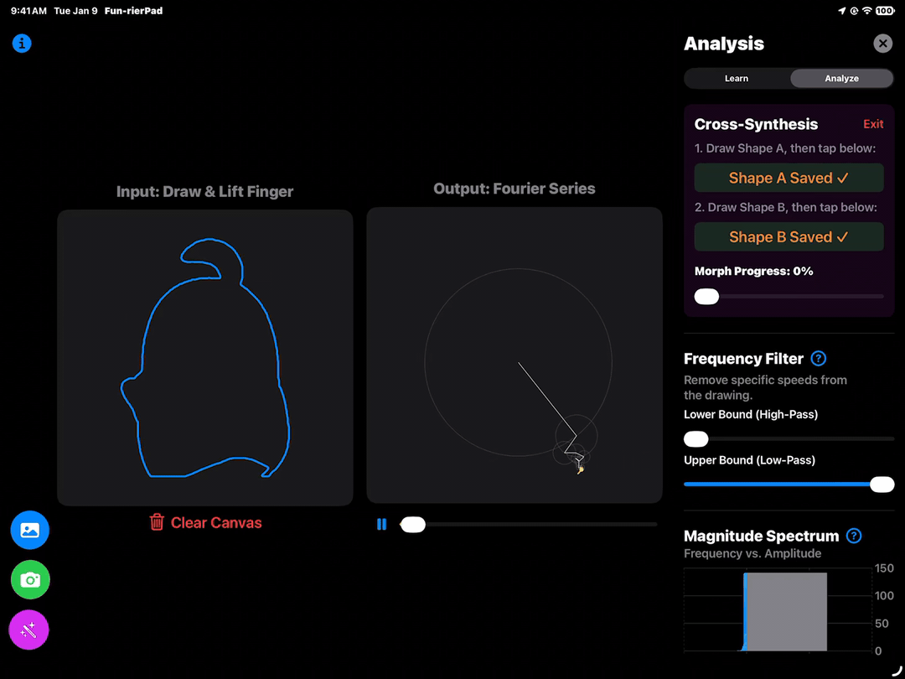
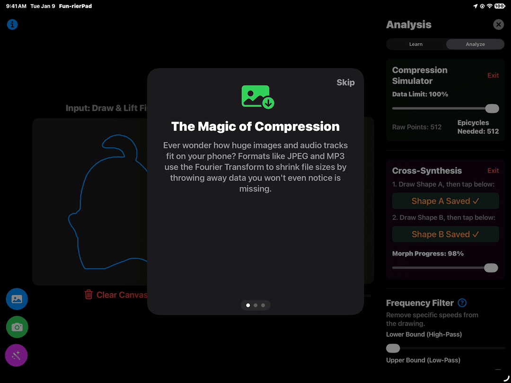
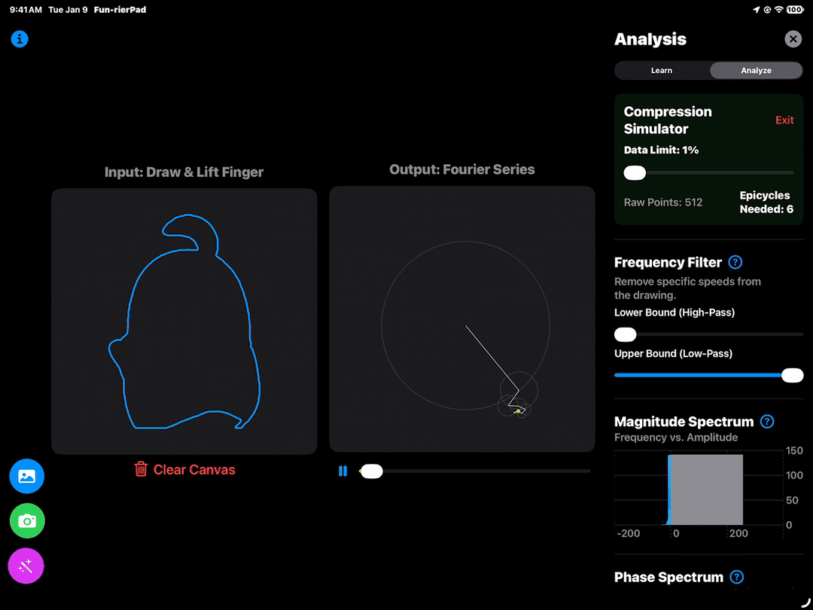

## FunrierPad

> [!NOTE]
> Full list of app features in [features.md](features.md)

Advanced mathematics, specifically signal processing and the Fourier Transform, is traditionally taught in a highly theoretical, equation-heavy manner that alienates visual learners. People interact with Fourier Transforms every day through JPEG images and MP3 audio, but the underlying concept might feel unintuitive as it involves some calculus.

I was unhappy with my Signals and Systems course at my university since we never used real-world data, so I wanted to create a visualization that offers a friendly, interactive sandbox. "FunrierPad" allows anyone to start drawing on a canvas, and see their drawings reconstructed using Fourier Transforms.

By using a canvas over mathematical expressions, users can get an intuitive understanding of Fourier Transform and its applications.

## Swift Functions Used

- Accelerate (vDSP): For 2D Fast Fourier Transform (FFT) calculations. It is incredibly fast and optimized, which allows for a responsive user experience updating the UI immediately.

- Vision Framework: To process images, both from camera-album and ImageCreator's AI-generated images. By using foreground instance masking and contour detection, the app can extract normalized vector points to represent the image into an array, then transform it with Accelerate as if the user drew it.

- FoundationModels & ImageCreator: One of the most recent features in Swift, I used them together to power the "Magic Wand" feature. The local, offline language model extracts the core intent from the user's prompt, then sends a request to ImageCreator to generate the shape, which then connects directly with the Vision pipeline.

- Swift Charts: In the "Analysis" drawer, it provides a clean, interactive visual representations of the magnitude and phase spectrums, so users can see the raw frequency data behind their shapes.

- SwiftUI Canvas: It handles the 60 fps rendering required to smoothly animate the chains of spinning epicycles and trace paths.

