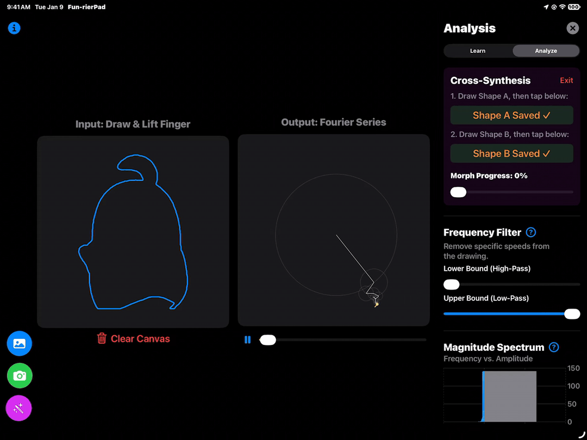
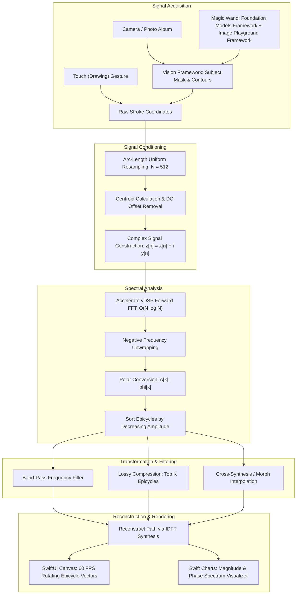
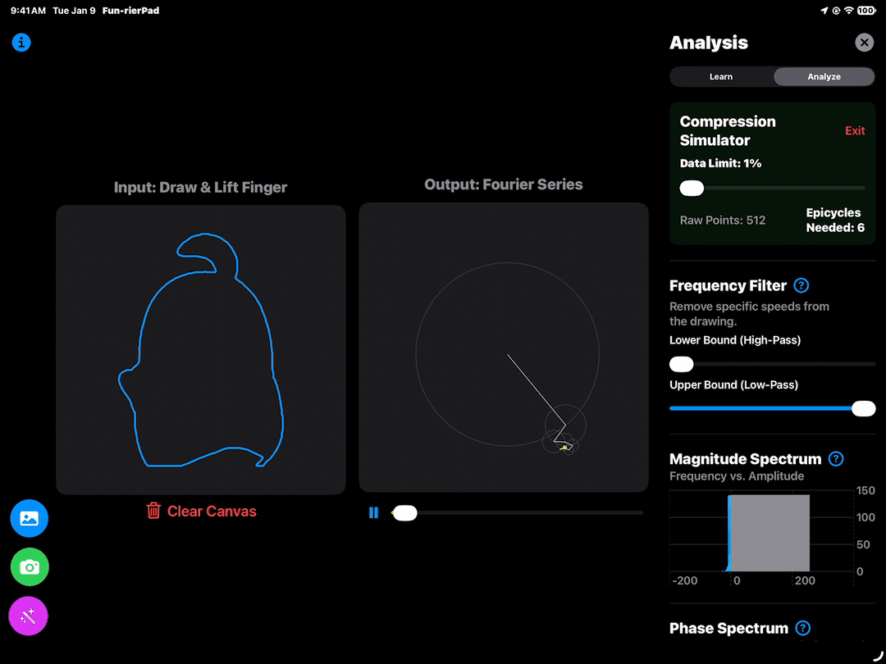
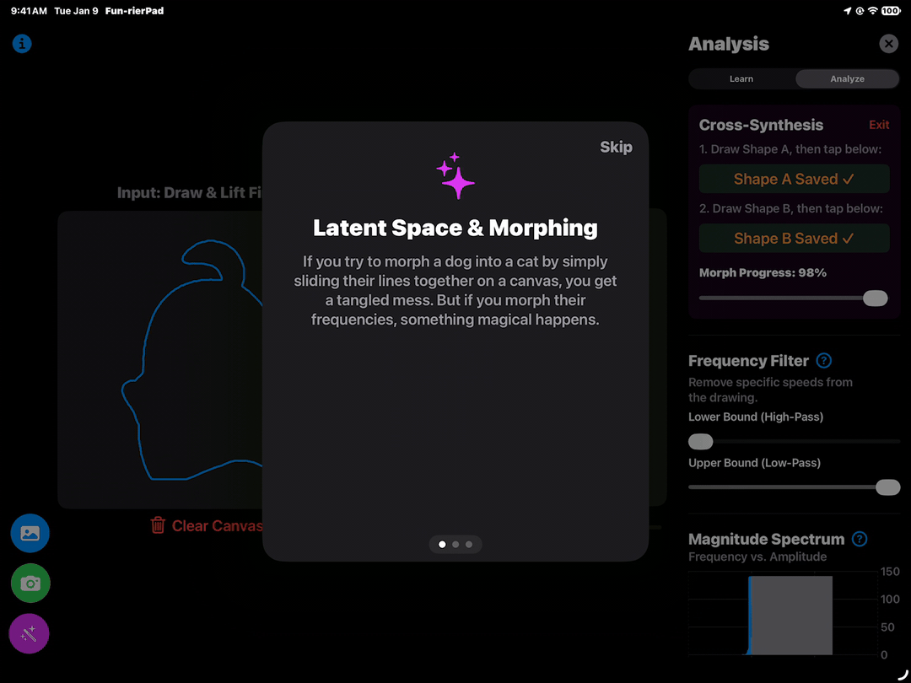
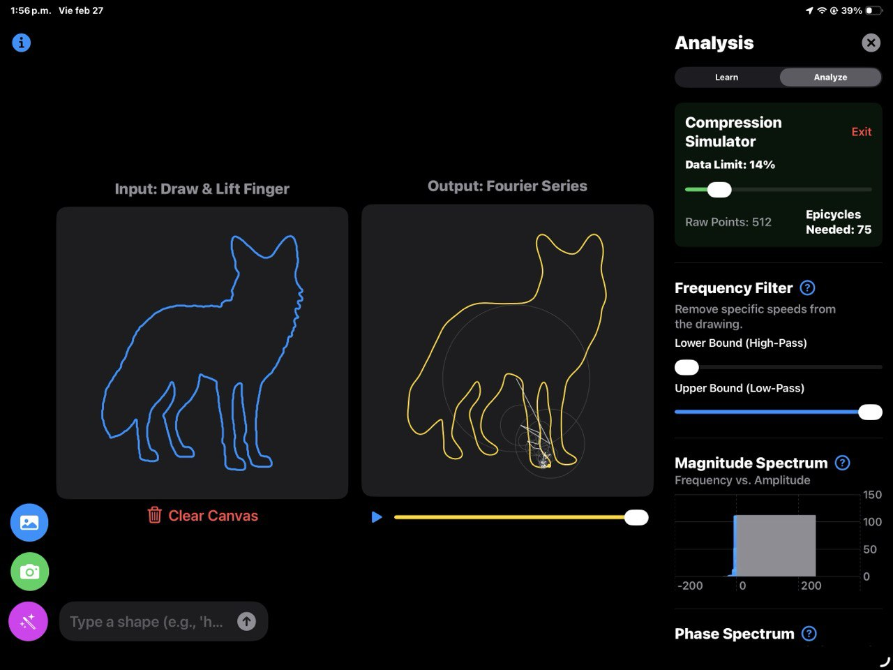
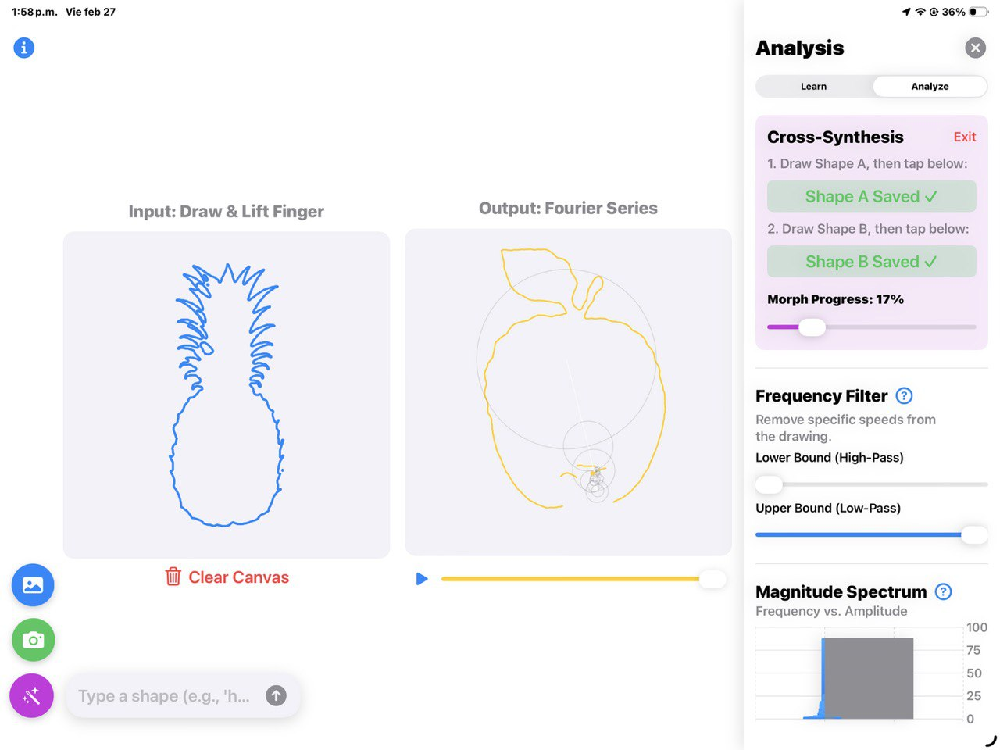
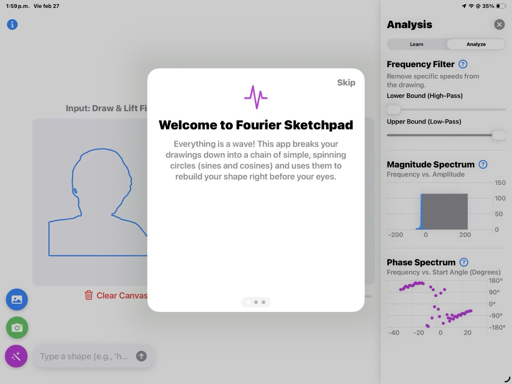

# FunrierPad: Architecture & Features Documentation

FunrierPad (Fourier Sketchpad) is an educational iOS / iPadOS application built using Swift Playgrounds that translates theoretical mathematical principles of the Fourier Transform and Digital Signal Processinginto an interactive, visual, and tactile sandbox.

Rather than approaching the Fourier Transform as static calculus equations or 1D sound wave graphs, FunrierPad represents any 2D closed or multi-stroke drawing as a complex-valued periodic signal $z(t) \in \mathbb{C}$. The app decomposes the signal into rotating complex phasors (epicycles) using Fast Fourier Transform (FFT), visualizes their constructive and destructive interference in real time, and demonstrates practical applications such as frequency filtering, lossy data compression, and spectral cross-synthesis.




## Table of Contents

1. [High-Level Pipeline & Architecture](#high-level-pipeline--architecture)
2. [Feature 1: Multi-Modal Signal Acquisition & Geometry Ingestion](#feature-1-multi-modal-signal-acquisition--geometry-ingestion)
3. [Feature 2: Signal Conditioning & Resampling Engine](#feature-2-signal-conditioning--resampling-engine)
4. [Feature 3: Hardware-Accelerated Discrete Fourier Transform](#feature-3-hardware-accelerated-discrete-fourier-transform-fft)
5. [Feature 4: Real-Time Epicycle Synthesis & Interactive Playback](#feature-4-real-time-epicycle-synthesis--interactive-playback)
6. [Feature 5: Real-Time Frequency Band Filtering](#feature-5-real-time-frequency-band-filtering)
7. [Feature 6: Interactive Spectral Analysis Drawer](#feature-6-interactive-spectral-analysis-drawer)
8. [Feature 7: Educational Simulation Modules](#feature-7-educational-simulation-modules)
9. [Feature 8: Interactive Guided Walkthroughs](#feature-8-interactive-guided-walkthroughs)
10. [Technical Stack & Signal Processing Mapping Summary](#technical-stack--signal-processing-mapping-summary)

***

## High-Level Pipeline & Architecture

The application operates as an end-to-end signal processing and synthesis pipeline:




## Feature 1: Multi-Modal Signal Acquisition & Geometry Ingestion



FunrierPad provides three distinct ways for users to introduce 2D spatial signals into the engine:

### Freehand Touch Drawing Canvas
- Located in [ContentView.swift](FunrierPad.swiftpm/ContentView.swift), the drawing input panel uses a SwiftUI `DragGesture(minimumDistance: 0)` overlaid on a responsive square aspect-ratio viewport.
- As the user drags, points are recorded into `currentStroke`. When the touch lifts, the stroke is committed to `finishedStrokes` and the signal processing pipeline is automatically triggered.

### Camera & Photo Library Ingestion
- Managed by [CameraPicker.swift](FunrierPad.swiftpm/CameraPicker.swift) and SwiftUI's `PhotosPicker` in [ContentView.swift](FunrierPad.swiftpm/ContentView.swift).
- Instead of hand-drawing, users can capture live physical objects or select photos directly from their photo album. Images are resized to a maximum bounding box of 1024 px to maintain deterministic performance.

### AI "Magic Wand" Generative Shape Extraction
- In the main screen, tapping the purple magic wand opens a prompt bar.
- Apple's [Foundation Models Framework](https://developer.apple.com/documentation/foundationmodels) `LanguageModelSession` parses natural language queries into pure semantic nouns. For example, a user input like *"draw a cute star for me"* becomes *"star"*.
- For standard shapes such as *heart*, *sine*, *wave*, *star*, *square*, a parametric mathematical equations are used to generate sample points directly.
- For arbitrary nouns such as *cat*, *guitar*, *airplane*, the app uses Apple's [Image Playground Framework](https://developer.apple.com/documentation/imageplayground) to prompt `ImageCreator` with a constraint prompt:
  *"A minimalist, single continuous black solid line drawing of a ${detectedIntent}, pure white background, no shading, flat 2d."*

### Computer Vision Contour Extraction

Apple's [Vision Framework](https://developer.apple.com/documentation/vision) `VNGenerateForegroundInstanceMaskRequest` is used to isolate the foreground subject from the background, creating a high-contrast binary pixel mask.

- The mask is processed by `VNDetectContoursRequest(detectsDarkOnLight = false)` to extract vector boundaries.
- Contour points are inverted along the Y-axis (converting Vision's bottom-left origin to SwiftUI's top-left origin), scaled to the preserved image aspect ratio, and normalized to fit the canvas viewport.

### Signal Processing Connection: Sampling, Discretization & Spatial Boundary Representations
- Continuous to Discrete Representation: A physical curve or object boundary in space is an analog 2D curve $(x(t), y(t))$ parameterized by arc time $t \in [0, T]$. Digitizing it requires spatial sampling.
- Edge Detection as Spatial Differentiation: In traditional signal processing, image edges correspond to high spatial frequency transients (discontinuities in pixel intensity gradient $\nabla I(x, y)$). The [Vision Framework](https://developer.apple.com/documentation/vision)'s foreground segmentation and contour extraction serve as a high-level spatial boundary filter, transforming a 2D intensity field $I(x, y)$ into a 1D closed parametric signal trajectory $z[n]$.


## Feature 2: Signal Conditioning & Resampling Engine

Before a 2D path can be converted into the frequency domain, it must be conditioned to satisfy the mathematical assumptions of the Discrete Fourier Transform. This is handled in [FourierCalculator.swift](FunrierPad.swiftpm/FourierCalculator.swift).

### Arc-Length Uniform Resampling
- Problem: Human touch input is recorded at non-uniform time intervals with varying dragging velocities. If raw gesture timestamps were used, drawing slowly would produce clustered sample points (artificially high frequency in space), while drawing quickly would space points far apart.
- Solution: The engine calculates total polygonal ink length $L = \sum |p_{i+1} - p_i|$ and subdivides the path into segments of equal Euclidean distance $\Delta s = \frac{L}{N - 1}$. The function `resampleSingleStroke` steps through consecutive line segments, performing linear interpolation between vertices whenever the cumulative distance crosses integer multiples of $\Delta s$.

### Multi-Stroke Sample Allocation & Pen-Lift Preservation

In `resampleStrokes(strokes,targetCount)`, total ink length is computed across all discrete strokes while ignoring the empty space (gaps) between pen-lifts.

Each stroke $k$ is allocated a fraction of the total budget $N$ (configured to $N = 512$):

$$N_k = \text{round}\left(N \times \frac{\text{length}(stroke_k)}{L_{\text{total}}}\right)$$

Any rounding discrepancies are adjusted by padding with the terminal point or trimming, ensuring the final array length strictly matches $N = 2^m$ as required by radix-2 FFT algorithms.

### Centering & DC Offset Removal

Before computing epicycles, the centroid (center of mass) of all points is calculated:

$$\bar{x} = \frac{1}{N} \sum_{n=0}^{N-1} x[n], \quad \bar{y} = \frac{1}{N} \sum_{n=0}^{N-1} y[n]$$

All coordinates are translated: $x'[n] = x[n] - \bar{x}, \; y'[n] = y[n] - \bar{y}$.

### Complex 2D Signal Formulation

The 2D coordinates are mapped onto the complex plane $\mathbb{C}$:

$$z[n] = x'[n] + i\,y'[n], \quad n = 0, 1, \dots, N-1$$

### Signal Processing Connection: Spatial Sampling Rate, Non-Uniform to Uniform Domain Mapping, and DC Elimination

**Uniform Sampling & Shannon-Nyquist**: Standard FFT algorithms assume uniformly spaced samples $z[n] = z(n \cdot T_s)$. Arc-length resampling converts an irregular time-domain touch signal into a uniform spatial-domain signal parameterized by arc-length $s$.

**DC Component ($X[0]$)**: In the Fourier series, the zero-frequency coefficient represents the DC component (average value of the signal):

$$X[0] = \sum_{n=0}^{N-1} z[n] = \sum x[n] + i \sum y[n] = N(\bar{x} + i\bar{y})$$

By subtracting $(\bar{x}, \bar{y})$ during preprocessing, the DC offset is pinned to the origin $(0, 0)$. This ensures the root epicycle remains stationed at the canvas center rather than drifting across the screen.


## Feature 3: Hardware-Accelerated Discrete Fourier Transform (FFT)

The transformation from spatial coordinates to rotational epicycles occurs in [FourierCalculator.swift](FunrierPad.swiftpm/FourierCalculator.swift).

### FFT via Apple Accelerate (`vDSP`)

FunrierPad uses Apple’s native vector-accelerated `vDSP` library:

```swift
let log2n = vDSP_Length(log2(Float(n)))
let fftSetup = vDSP_create_fftsetup(log2n, FFTRadix(kFFTRadix2))
vDSP_fft_zip(fftSetup, &complexBuffer, 1, log2n, FFTDirection(kFFTDirection_Forward))
vDSP_destroy_fftsetup(fftSetup)
```

A naive Discrete Fourier Transform requires matrix-vector multiplication with $O(N^2)$ complex operations. By employing the [Cooley-Tukey](https://web.stanford.edu/class/cme324/classics/cooley-tukey.pdf) Radix-2 algorithm through `vDSP_fft_zip`, the computation is executed in $O(N \log_2 N)$ time. For $N = 512$, this reduces the operation count by more than 90%, enabling instantaneous recalculations on user touch interactions.

### Negative Frequency Unwrapping & Dual-Direction Phasors

The output buffer of a standard complex forward FFT contains frequencies ordered from $k = 0$ to $N - 1$. In `FourierCalculator.convertToEpicycles`, indices above $N/2$ are converted to negative frequencies:

```swift
var freq = k
if k > Int(n) / 2 {
  freq = k - Int(n)
}
```

This shifts the frequency range from $[0, N-1]$ to the symmetric two-sided interval $[-\frac{N}{2}+1, \frac{N}{2}]$.

### Polar Decomposition
Each complex coefficient $Z[k] = \text{Re}[k] + i \cdot \text{Im}[k]$ is decomposed into polar coordinates:

$$\text{Amplitude: } A_k = \frac{\sqrt{\text{Re}[k]^2 + \text{Im}[k]^2}}{N}$$

$$\text{Phase: } \phi_k = \text{atan2} \left(\text{Im}[k], \text{Re}[k] \right)$$

### Harmonic Sorting

Epicycles are sorted in descending order of their amplitudes ($A_0 \ge A_1 \ge A_2 \dots$). This structural reorganization ensures that when epicycles are chained together, the largest circles form the primary structural spine of the drawing, while smaller circles contribute subtle high-frequency details.

### Signal Processing Connection: Complex Exponential Basis, Direction of Rotation, and Energy Compaction

**1D Complex Signal Representation of 2D Curves**: While real-valued audio signals have Hermitian symmetry $X[-k] = X^*[k]$ where negative frequencies are redundant, a 2D planar curve represented as a complex signal $z[n] = x[n] + i\,y[n]$ does not have conjugate symmetry. Negative frequencies are mathematically independent from positive frequencies.

Clockwise vs. Counter-Clockwise Rotation:
- Positive frequency $+k$ represents a circular phasor rotating counter-clockwise: $e^{+i k \omega_0 t}$
- Negative frequency $-k$ represents a circular phasor rotating clockwise: $e^{-i k \omega_0 t}$
- In 2D plane geometry, the superposition of two counter-rotating circles of equal amplitude produces linear rectilinear motion:

$$\frac{1}{2} e^{i \omega t} + \frac{1}{2} e^{-i \omega t} = \cos(\omega t)$$

- By combining positive and negative frequencies of varying amplitudes and phases, epicycles can trace arbitrary non-circular geometries, including straight lines, sharp corners, and cusps.

**Energy Compaction Property**: In transform theory, most energy of smooth natural curves is concentrated in a small subset of low-order harmonics. Sorting by amplitude concentrates signal energy into the leading terms.


## Feature 4: Real-Time Epicycle Synthesis & Interactive Playback


In [EpicycleView.swift](FunrierPad.swiftpm/EpicycleView.swift), the Fourier coefficients are brought to life through epicycles animation.

### Dynamic Kinematic Chain of Rotating Phasors

For each epicycle $k$, a circle of radius $A_k$ is drawn at the current vector tip $(x_{k-1}, y_{k-1})$. An arm extending from the center of the circle to its perimeter is computed using:

$$\theta_k(t) = \phi_k + \omega_k t = \phi_k + (2\pi \cdot k \cdot \text{progress})$$

$$x_k(t) = x_{k-1}(t) + A_k \cos(\theta_k(t)), \quad y_k(t) = y_{k-1}(t) + A_k \sin(\theta_k(t))$$

The end of the final arm represents the virtual "pen tip" (highlighted as a yellow dot) tracing out the synthesized path.

### Precomputed Path Synthesis & Discontinuity Suppression

- In `FourierCalculator.reconstructPath`, the closed trajectory $z(t)$ for $t \in [0, 2\pi)$ is precalculated across 512 discrete steps using IDFT synthesis. This avoids running trigonometric loops for the entire historical path on every frame.
- In multi-stroke drawings, connecting separate strokes would cause ugly straight-line connecting chords. In `EpicycleView.Canvas`, the renderer calculates the Euclidean distance between consecutive points:

```swift
let jumpThreshold: CGFloat = 8.0
if dist > jumpThreshold {
  tracePath.move(to: currentPoint)
} else {
  tracePath.addLine(to: currentPoint)
}
```

If the displacement exceeds `jumpThreshold`, the virtual pen lifts, preserving the visual separation between strokes.

### 60 FPS Canvas Rendering & Time Scrubber

- Utilizes SwiftUI `Canvas` with an automated Timer publish for smooth 60 FPS playback.
- A playback slider lets the user pause animation, jump to any point in the cycle, and inspect the exact orientation of every rotating arm at any instance in time.

### Signal Processing Connection: Inverse DFT Synthesis, Phasor Addition, and Gibbs Phenomenon

**Inverse Discrete Fourier Transform (IDFT)**: The animation is an explicit realization of the continuous-time synthesis equation:

$$z(t) = \sum_{k} X[k] e^{i \omega_k t} = \sum_{k} A_k e^{i (\omega_k t + \phi_k)}$$

Each rotating arm represents an individual Fourier basis function (a rotating complex phasor), and vector tip chaining represents continuous phasor summation.

**Gibbs Phenomenon**: When drawing shapes with sharp discontinuities (such as a square or star), epicyclic reconstruction exhibits characteristic ringing/overshoot near sharp corners. The app allows users to visually observe this mathematical consequence of truncating a Fourier series representing a non-smooth signal.


## Feature 5: Real-Time Frequency Band Filtering

Located in [AnalysisDrawerView.swift](FunrierPad.swiftpm/AnalysisDrawerView.swift) and evaluated in [ContentView.swift](FunrierPad.swiftpm/ContentView.swift).

### Dual-Slider Frequency Gate

Two sliders define normalized frequency boundaries:
- Lower Bound `minFreqRatio`: High-pass cutoff threshold.
- Upper Bound `maxFreqRatio`: Low-pass cutoff threshold.

The cutoff frequencies in Hertz / cycles-per-period are determined dynamically:

$$f_{\text{highest}} = \max_k |f_k|, \quad f_{\text{min}} = f_{\text{highest}} \times \text{safeMin}, \quad f_{\text{max}} = f_{\text{highest}} \times \text{safeMax}$$

Epicycles whose absolute frequency $|f_k|$ falls outside $[f_{\text{min}}, f_{\text{max}}]$ are eliminated.

### Geometric Effects of Filtering

- Low-Pass Filtering ($f_{\text{min}} = 0$, $f_{\text{max}} < 1.0$):
  Eliminates rapid spinning epicycles. The shape sheds sharp corners, pen jitters, and minute details, collapsing into a smooth, rounded blob representing the fundamental structural macro-geometry.
- High-Pass Filtering ($f_{\text{min}} > 0$, $f_{\text{max}} = 1.0$):
  Eliminates the slow-spinning, large epicycles. The global position and broad structure vanish, leaving only tiny fluttering loops that trace sharp corners, rapid velocity changes, and stroke transients.
- Band-Pass Filtering ($0 < f_{\text{min}} < f_{\text{max}} < 1.0$):
  Isolates oscillations occurring within a specific geometric scale or spatial frequency band.

### Signal Processing Connection: Frequency Domain Multiplication, Circular Convolution, and Spectral Bandwidths

In the frequency domain, filtering corresponds to multiplying the signal spectrum $X[k]$ by an ideal rectangular window transfer function $H[k]$:

$$Y[k] = X[k] \cdot H[k], \quad \text{where } H[k] = \begin{cases} 1 & \text{if } f_{\text{min}} \le |k| \le f_{\text{max}} \\ 0 & \text{otherwise} \end{cases}$$

Convolution Theorem: Multiplication in the discrete frequency domain ($X[k] \cdot H[k]$) corresponds to [circular convolution](https://ocw.mit.edu/courses/6-341-discrete-time-signal-processing-fall-2005/6e5190ef6e0d66c78bfdce2be6ce7125_lec16.pdf) in the spatial domain $z[n] \circledast h[n]$, where $h[n] = \text{IDFT}\{H[k]\}$ is a periodic discrete sinc-like kernel.

Spatial Frequency Interpretation in 2D drawing analysis:
- Low spatial frequencies $\leftrightarrow$ coarse global geometry and topology
- High spatial frequencies $\leftrightarrow$ localized edges, corners, and fine spatial details


## Feature 6: Interactive Spectral Analysis Drawer

Built using Apple's [Swift Charts Framework](https://developer.apple.com/documentation/charts) in [AnalysisDrawerView.swift](FunrierPad.swiftpm/AnalysisDrawerView.swift), providing real-time diagnostic plots of the underlying Fourier spectrum.

### Magnitude Spectrum Plot with Dynamic Filter Overlay

- BarMark Representation: Displays frequency index $k$ on the horizontal axis against amplitude $A_k$ on the vertical axis for the top 50 coefficients.
- Transfer Function State Feedback: The chart combines data marks with an underlying shaded `RectangleMark`:
  - Active harmonics passing the filter window ($f_{\text{min}} \le |k| \le f_{\text{max}}$) are styled with a bright blue gradient
  - Attenuated harmonics are dimmed to translucent gray ($0.3$ opacity)
  - The passband window $[f_{\text{min}}, f_{\text{max}}]$ is highlighted across the background as a shaded region representing the filter's transfer function $H[k]$

### Phase Spectrum Plot

The PointMark representation plots the initial phase angle $\phi_k$ of each frequency harmonic.

Angular Mapping converts internal radians to conventional engineering degrees $[-180^\circ, +180^\circ]$:

$$\phi_{\text{deg}} = \phi_k \times \frac{180}{\pi}$$

Fixed vertical axis lines at $-180^\circ, -90^\circ, 0^\circ, +90^\circ, +180^\circ$ visualize the phase distribution.

### Signal Processing Connection: Spectral Energy Density, Parseval's Theorem, and Phase Coherence

[Parseval's theorem](https://ethz.ch/content/dam/ethz/special-interest/mavt/dynamic-systems-n-control/idsc-dam/Lectures/Signals-and-Systems/Lectures/LN5.pdf) states that the total energy in the spatial domain equals the total energy in the spectral domain:

$$\sum_{n=0}^{N-1} |z[n]|^2 = \frac{1}{N} \sum_{k} |X[k]|^2$$

The magnitude spectrum enables users to inspect how energy is partitioned across harmonics.

**Importance of Phase in Waveform Synthesis**: While the magnitude spectrum indicates how much of each frequency exists, the phase spectrum dictates when each harmonic peaks. Randomizing or zeroing out the phase angles while keeping the identical magnitude spectrum destroys the geometric shape completely, visually proving that spatial structure is fundamentally encoded in phase relationships.


## Feature 7: Educational Simulation Modules



Accessible via the `Learn` tab in [AnalysisDrawerView.swift](FunrierPad.swiftpm/AnalysisDrawerView.swift), the app features two dedicated interactive labs demonstrating real-world applications of Fourier theory:

### Lossy Compression Simulator (Energy Compaction & Truncation)

- Concept & UI: Users adjust a "Data Limit" slider from 100% down to 1%
- Implementation in [ContentView.swift](FunrierPad.swiftpm/ContentView.swift):

```swift
if isCompressionMode {
  let limit = max(1, Int(Double(filtered.count) * compressionDataLimit))
  filtered = Array(filtered.prefix(limit))
}
```

Since epicycles are sorted by amplitude descending, reducing the data limit discards the weakest coefficients. The UI contrasts the uncompressed raw point count (512 points $\times$ 2 coordinates) with the active number of epicycles retained.

Users discover that dropping the data limit to 10% ~ 15% produces an almost indistinguishable reproduction of their drawing, while dropping below $3\%$ causes significant degradation.

#### Signal Processing Connection: Rate-Distortion Theory & Lossy Compression Codecs (JPEG, MP3)



This module directly mirrors transform coding used in industry standards:
- [JPEG](https://arxiv.org/pdf/1405.6147): Uses the 2D Discrete Cosine Transform (DCT) to transform $8 \times 8$ pixel blocks, discarding high-frequency coefficients with negligible perceptual weight
- [MP3 / AAC](http://www.mp3-tech.org/programmer/docs/jacaba_main.pdf): Uses the Modified Discrete Cosine Transform ([MDCT](https://doi.org/10.1109/ICSC45622.2019.8938213)) and psychoacoustic models to drop low-energy spectral components masked by louder sounds

This demonstrates Energy Compaction: A well-chosen orthogonal basis allows representing the vast majority of signal information using a tiny fraction of transform coefficients.


### Latent Space Cross-Synthesis (Frequency Domain Shape Morphing)



- Concept & UI: Users save two independent shapes (Shape A and Shape B) and use a "Morph Progress" slider from 0.0 to 1.0 to smoothly transform between them.
- Implementation: Located in `FourierCalculator.interpolateEpicycles` in [FourierCalculator.swift](FunrierPad.swiftpm/FourierCalculator.swift):
  1. Compiles a union set of all frequencies present in either Shape A or Shape B. Frequencies absent from one shape default to zero amplitude.
  2. Rectangular Conversion: Converts polar parameters $(A, \phi)$ into Cartesian coordinates $(Re, Im)$:
     $$Re = A \cos(\phi), \quad Im = A \sin(\phi)$$
  3. Linear Vector Interpolation:
     $$Re_{\text{interp}} = Re_A(1 - p) + Re_B(p), \quad Im_{\text{interp}} = Im_A(1 - p) + Im_B(p)$$
  4. Polar Reconversion:
     $$A_{\text{interp}} = \sqrt{Re_{\text{interp}}^2 + Im_{\text{interp}}^2}, \quad \phi_{\text{interp}} = \text{atan2}(Im_{\text{interp}}, Re_{\text{interp}})$$
  5. Sorts the interpolated epicycles by amplitude and synthesizes the intermediate path.

#### Signal Processing Connection: Cross-Synthesis, Phase Unwrapping, and Frequency Domain Interpolation

- Linearly interpolating spatial points between two arbitrary shapes requires point-to-point correspondence and typically produces catastrophic self-intersections, pinching, and collapsed vertices.
- By interpolating in the frequency domain, the transformation smoothly blends the harmonics of both signals.
- Interpolating phase angles directly in polar form $\phi_{\text{interp}} = \phi_A(1-p) + \phi_B(p)$ suffers from the modulo-$2\pi$ branch cut discontinuity: interpolating between $+\pi$ and $-\pi$ causes the phasor to swing $360^\circ$ in reverse. By interpolating in Cartesian complex space $(Re, Im)$, phasors glide straight through the complex plane without artificial spinning artifacts.


## Feature 8: Interactive Guided Walkthroughs



Implemented in [WalkthroughView.swift](FunrierPad.swiftpm/WalkthroughView.swift):
- First Launch: Shows the app features listed above, and how to use some signal processing tools like filtering frequency.
- Compression Walkthrough: Explains perceptual coding, dropping quiet frequencies, and how MP3/JPEG discard imperceptible data.
- Morp hWalkthrough: Explains latent space, why geometric point morphing fails, and how frequency-space cross-synthesis creates natural topological transformations.


## Technical Stack & Signal Processing Mapping Summary

| App Feature | Primary Swift Frameworks & APIs | Signal Processing & Mathematical Topics |
| :--- | :--- | :--- |
| Touch Gesture Canvas | SwiftUI.DragGesture, Path | Spatial sampling, non-uniform time-series discretization, 2D parametric curves $(x(t), y(t))$ |
| Image & Camera Ingestion | PhotosUI, UIKit.UIImagePickerController | Discrete 2D spatial intensity fields, image resizing and decimation |
| Contour Extraction | Vision, CoreImage | Spatial boundary segmentation, edge detection, gradient analysis $\nabla I(x,y)$, contour parameterization |
| AI Shape Generator | Foundation Models, Image Playground | Semantic intent extraction, parametric curves (cardioid, sinusoidal waves, regular star polygons) |
| Stroke Resampling Engine | Custom Euclidean arc-length interpolation | Uniform spatial resampling rate, Shannon-Nyquist considerations, stroke length partitioning |
| Centering & DC Removal | CoreGraphics.CGPoint vector arithmetic | Centroid calculation, zero-frequency removal ($X[0] = 0$), stationary orbital center |
| Fast Fourier Transform | Accelerate.vDSP | Discrete Fourier Transform (DFT), Cooley-Tukey radix-2 $O(N \log N)$ algorithm, complex split buffer |
| Epicycle Frequency Unwrapping | Modular arithmetic on FFT bins | Negative frequencies, dual-direction rotation (counter-clockwise $e^{i\omega t}$ vs clockwise $e^{-i\omega t}$), elliptical/rectilinear planar synthesis |
| Epicycle Visualizer | SwiftUI.Canvas, Combine.Timer | Inverse DFT (IDFT) synthesis, phasor addition, Euler's formula $e^{i\theta} = \cos\theta + i\sin\theta$, kinematic chain |
| Path Reconstructor & Jump Filter | Vector distance thresholding | Precomputed analytical IDFT, handling discontinuous piecewise signals, pen-lift suppression, Gibbs phenomenon |
| Band-Pass Filtering | State-driven filtering sliders | Frequency-domain multiplication $Y[k] = X[k] H[k]$, circular convolution, low-pass smoothing vs high-pass edge emphasis |
| Spectral Drawer | Charts.Chart | Magnitude spectrum $X[k]$, phase spectrum $\angle X[k]$, energy compaction, Parseval's theorem, phase coherence |
| Compression Simulator | Dynamic coefficient truncation | Transform coding, lossy compression (JPEG, MP3), rate-distortion trade-offs |
| Cross-Synthesis Morphing | Complex rectangular vector interpolation (FourierCalculator) | Spectral morphing, latent-space blending, branch cut discontinuity avoidance, polar-to-Cartesian mapping |

